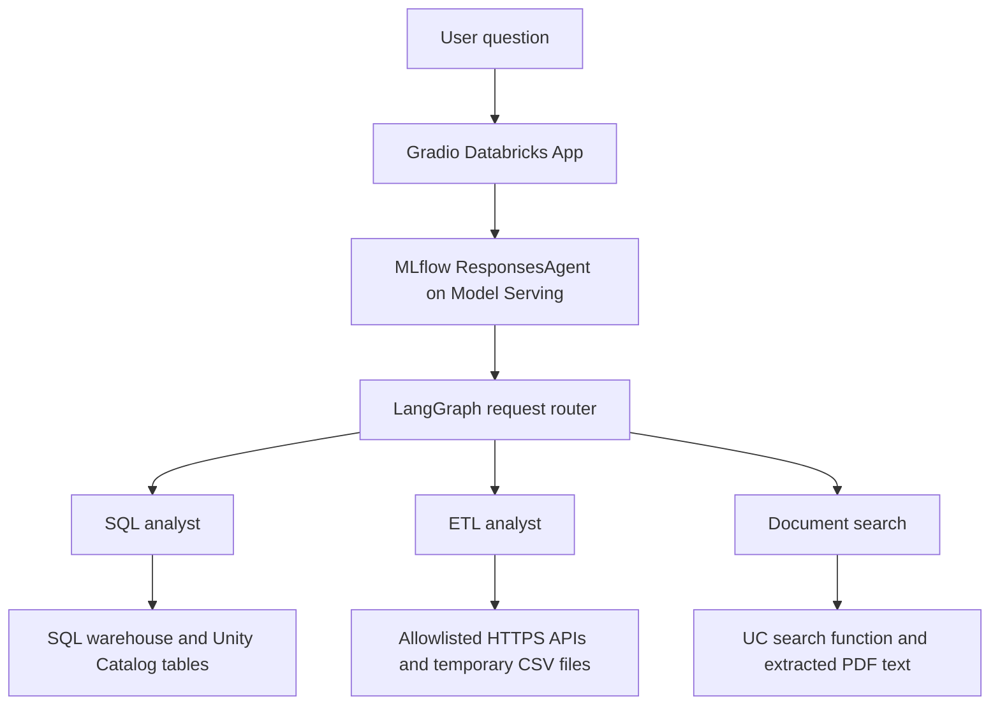

# AI Data Agent

AI Data Agent is a conversational assistant for customer-support data on Databricks. Users ask questions in plain English, and the agent routes each request to a SQL analyst, an ETL workflow, or a product-document search tool. It brings structured customer-service data and PDF documentation into one chat interface.

The project demonstrates an end-to-end agent application: prepare data in Unity Catalog, expose tools, orchestrate workflows with LangGraph, register the agent with MLflow, deploy it to Model Serving, and access it through a Gradio Databricks App.

## What can it do?

| Capability | Example request | What happens |
| --- | --- | --- |
| Answer data questions | "How many customer service tickets are there?" | Generates and validates a read-only SQL query, executes it on a SQL warehouse, and explains the result. |
| Search product documentation | "What features does AccountEase Pro offer?" | Searches extracted PDF text and answers using retrieved documentation. |
| Perform bounded ETL | "Extract posts from https://jsonplaceholder.typicode.com/posts, keep id and title, and inspect the result." | Uses approved extraction and CSV transformation tools, then summarizes verified tool results. |

## How it works



The app sends conversation history to the serving endpoint. The SQL workflow uses schema context, deterministic query validation, an LLM judge, and bounded execution. The ETL workflow calls a limited set of tools. Document search retrieves text through a Unity Catalog function. Databricks authentication and model endpoints are used throughout; no separate OpenAI or Anthropic API key is required.

## Repository guide

| Path | Purpose |
| --- | --- |
| `src/agents/agent.py` | Request routing, specialized workflows, and MLflow ResponsesAgent wrapper. |
| `src/agents/runtime.py` | SQL validation/execution and bounded ETL operations. |
| `src/app/app.py` | Gradio chat interface and serving-endpoint client. |
| `src/notebooks/01_load_data.py` | CSV loading and PDF text extraction. |
| `src/notebooks/02_create_uc_functions.py` | Schema and data-access tools registered in Unity Catalog. |
| `src/notebooks/03_build_deploy_agent.py` | MLflow registration and serving deployment. |
| `databricks.yml`, `resources/` | Declarative Automation Bundle configuration for the job and app. |
| `scripts/verify_deployment.py` | Live SQL, document-search, ETL, and app checks. |
| `tests/test_runtime.py` | Offline runtime and agent tests. |

## Project showcase

Explore the [Multi-Agent Architecture site](https://pratik2895.github.io/ai-data-agent/) for the architecture diagram, working-app screenshot, deployed resources, usage examples, and a guide to adapting the project to your own workspace.

## Deployment status

Verified **October 11, 2026**: model version **5** is READY / NOT_UPDATING and the Databricks app is RUNNING. All four live deployment checks passed: SQL returned the warehouse-verified 1,023 tickets, document search cited a product PDF, ETL transformed 100 rows into `id` and `title`, and app chat returned the correct ticket count. The latest offline run passed 19 tests.

The setup job loaded three CSV tables and extracted 509 PDFs. ETL files remain temporary; document retrieval uses lexical matching over extracted text. These checks verify the tested paths, not universal answer accuracy or production readiness. This is a dated snapshot, not a live status monitor.

## Setup

Requires Python 3.11 and Databricks CLI >=1.0. Authenticate to the selected workspace:

```powershell
databricks auth login --profile dev-52d59088
uv venv --python 3.11
uv pip install --python .venv/Scripts/python.exe -r requirements.txt pytest
.venv/Scripts/python.exe -m pytest -q tests
databricks bundle validate --strict --profile dev-52d59088
databricks bundle deploy --profile dev-52d59088
databricks bundle run setup_ai_data_agent --profile dev-52d59088
databricks bundle run ai_data_agent_app --profile dev-52d59088
```

The app uses the GitHub branch configured in `resources/app.yml`; push source changes there before deploying the app. The workspace requires Git-backed Apps.

Serving provisioning is asynchronous: check that `state.ready` is `READY` and `state.config_update` is `NOT_UPDATING` before querying the endpoint.

The setup job copies the existing customer-service CSVs from the configured source volume, creates the target catalog/schema/volume, loads Delta tables, extracts text from PDFs, registers UC tools, logs the agent, and deploys the named serving endpoint. Supply `--var warehouse_id=<id>` for another SQL warehouse and override catalog/schema/source variables for another environment. Synchronous deployment errors fail the job; asynchronous serving failures must be detected with the readiness and live checks below.

## Runtime

SQL runs through question curation, schema context, generation, deterministic SELECT-only catalog/schema validation, an LLM judge, bounded warehouse execution, and answer formatting. Results include column names and truncation status. Resource dependencies are declared to MLflow for serving authentication.

ETL supports HTTPS JSON extraction, CSV inspection, column selection, duplicate removal, null removal, and CSV loading into its working directory. The default allowlist contains `jsonplaceholder.typicode.com`; configure `ETL_ALLOWED_HOSTS` explicitly for other APIs. Redirects, path traversal, oversized inputs, and arbitrary generated Python execution are rejected. Outputs are temporary serving-instance files; they are not durable Unity Catalog tables or user downloads. Configure a durable execution service before using this ETL workflow in production. Tool loops stop after 20 graph steps.

Knowledge search uses the extracted PDF text via a UC function. Text extraction uses pypdf; scanned PDFs need OCR preprocessing. This implementation does not provision a Vector Search index.

Local invocation uses the same agent runtime and Databricks authentication; no separate OpenAI or Anthropic key is required. Load `.env` from `.env.example` with python-dotenv if desired, and invoke `src.agents.agent.DataAgent` with `ResponsesAgentRequest`. Run `.venv/Scripts/python.exe main.py "How many customer service tickets are there?" --profile dev-52d59088` after copying `.env.example` to `.env`. The local runner obtains CLI OAuth credentials in memory without writing or displaying them.

## Validation

GitHub Actions runs the offline tests and Python compilation on pushes and pull requests.

`tests/test_runtime.py` covers unsafe SQL, cross-catalog queries, CTEs, path traversal, API URL boundaries, SQL failures, CSV transformations, the SQL graph, and ResponsesAgent output. Cloud deployment additionally requires source-data access, catalog/schema create rights, SQL warehouse usage, UC function execution, and available model-serving compute.

## Verify a deployment

Once the setup job finishes and the serving endpoint is fully ready, run:

```powershell
.venv/Scripts/python.exe scripts/verify_deployment.py --profile dev-52d59088 --host https://dbc-316f5fb6-3c9c.cloud.databricks.com --warehouse-id 0a214d63e620a999
```

This checks SQL results against the warehouse, PDF citations, API extraction/CSV transformation, and the Gradio app through authenticated APIs. It writes a local `deployment-verification.json` report without credentials. The app now deploys from the merged `main` branch. UC tool creation uses metadata and SQL warehouse APIs, avoiding Spark initialization for that task.
